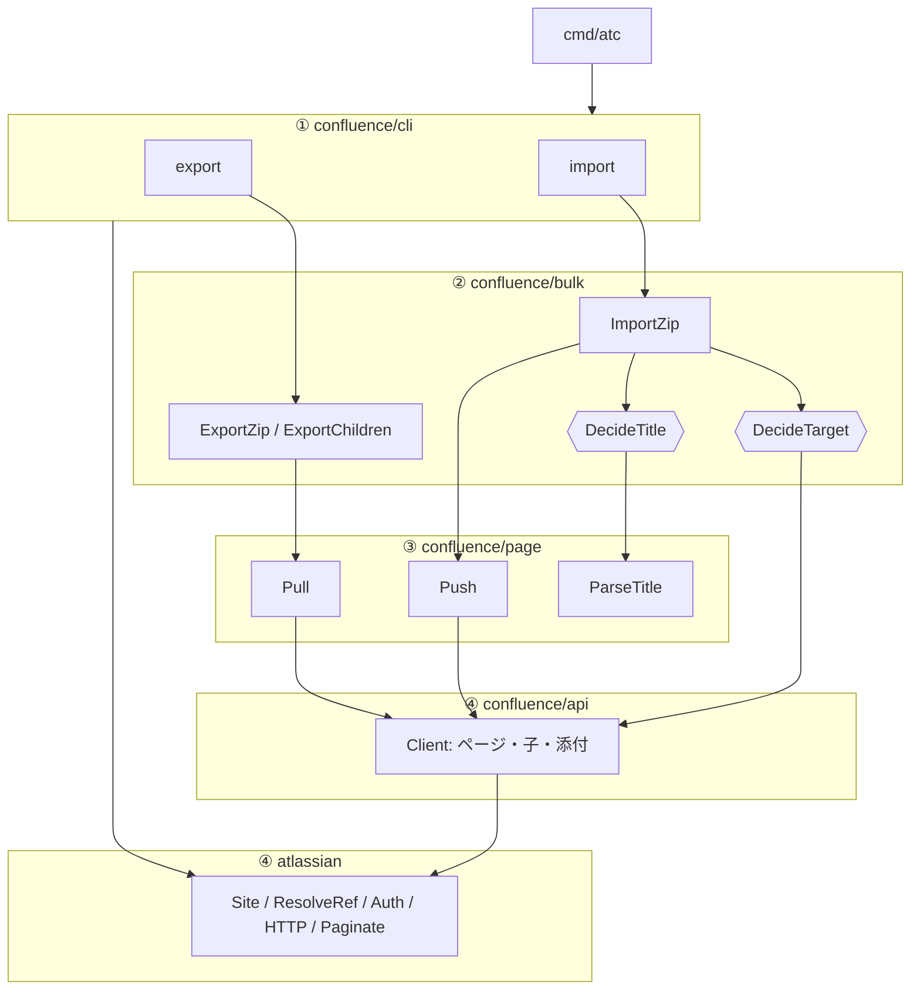
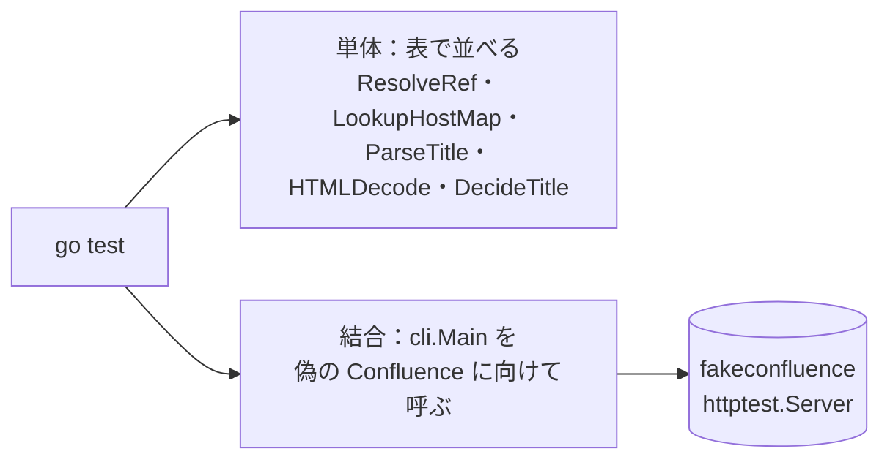
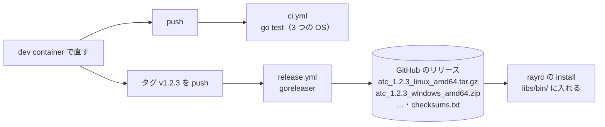
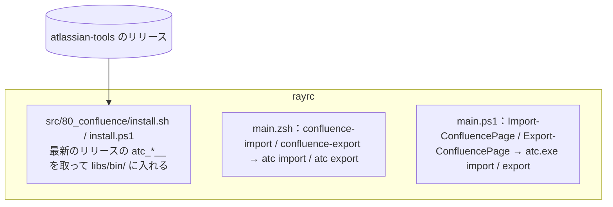

# atlassian-tools 設計

[requirement.md](requirement.md) の要件を、Go でどう作るかを書きます。

## 1. 方針

- **言語は Go**。HTTP・multipart・zip・sha256・JSON・HTML のエスケープが標準ライブラリにそろっていて、`CGO_ENABLED=0` で、どの OS 向けのバイナリも Linux の上で作れます。Rust は、Windows 向けにクロスビルドするのに mingw か `cargo-zigbuild` などが要るうえ、メモリ安全や性能という強みが、HTTP をつなぐだけのこの道具では活きません。
- **1 つのリポジトリ、1 つの Go モジュールから、製品ごとに別のバイナリ**を作ります。Go では `cmd/<名前>/` ごとに `package main` を置けば、それぞれが別のバイナリになります。共通の部分は `internal/` に置き、バイナリの間で使い回します。
- **決まりはシェル版から変えません**。シェル版の 4 層（① CLI・② 一括・③ ページ・④ 共通）を、そのままパッケージにします。「何が正か」を決めるのは ② の 2 つの関数だけ、zip を扱うのは ② だけ、という決めごとも同じです。
- **依存は小さく**。外部のモジュールは、オプションの読み取り（`spf13/pflag`）と、画面に出さない入力（`golang.org/x/term`）の 2 つだけにします。

## 2. リポジトリの形

```
atlassian-tools/
├── cmd/
│   ├── atc/main.go                 ① Confluence の CLI の入口（数行。internal/confluence/cli を呼ぶ）
│   └── atj/main.go                 （のちに）Jira
├── internal/
│   ├── atlassian/                  ④ 共通（製品をまたぐ）：サイト、認証、HTTP、ページ送り、エラー
│   ├── confluence/
│   │   ├── cli/                    ① オプションを読んで確かめ、② に渡す
│   │   ├── bulk/                   ② zip とフォルダの配置、入れ子、入れ先とタイトルの決定
│   │   ├── page/                   ③ ページのフォルダ ⇔ Confluence のページ 1 枚
│   │   └── api/                    ④ Confluence の REST API（型の付いた呼び出し）
│   └── testutil/fakeconfluence/    テスト用の偽の Confluence（httptest）
├── docs/
│   ├── requirement.md
│   └── design.md
├── .devcontainer/devcontainer.json
├── .github/workflows/{ci.yml,release.yml}
├── .goreleaser.yaml
├── Makefile
├── go.mod                          module github.com/<owner>/atlassian-tools
└── README.md
```

- `internal/` に置くのは、外のモジュールから import させないためです（公開するのはバイナリで、Go のライブラリではない）。
- ④ を 2 つに分けます。サイト・認証・HTTP の呼び方・ページ送りは Jira や Bitbucket でも同じなので `internal/atlassian`、Confluence の URL と JSON の形は `internal/confluence/api` です。`atj` を作るときは `internal/jira/{cli,bulk,…}` と `internal/jira/api` を足し、`internal/atlassian` を使い回します。

## 3. 層とパッケージ



依存は上から下へだけ。下の層は上の層を import しません（Go では循環 import がそもそもできないので、自然に守られます）。

### 3.1 ④ `internal/atlassian`

```go
// サイト（https://<ホスト名>、小文字）
type Site string
func ParseSite(s string) (Site, error)
func (s Site) Host() string

// ページの指定（URL か ID）→ サイトと ID。数字だけのときは defaultSite を呼ぶ
type Ref struct { Site Site; ID string }
func ResolveRef(s string, defaultSite func() (Site, error)) (Ref, error)

// 認証。ホスト名=値 のマップを環境変数から読み、なければ端末で入力を求める
type Credentials struct { Email, Token string }
func LookupHostMap(raw, host string) (value string, ok bool, warnings []string)
func ResolveCredentials(host, emailFlag string, env Env, prompt Prompter) (Credentials, error)

// HTTP。Basic 認証、User-Agent、タイムアウト、4xx/5xx を error に、429 は Retry-After を見て待つ
type Client struct { Site Site; HTTP *http.Client; cred Credentials }
func (c *Client) Do(ctx context.Context, req *http.Request) (*http.Response, error)
func (c *Client) GetJSON(ctx context.Context, path string, v any) error

// ページ送り（start と size、_links.next）
func Paginate[T any](ctx context.Context, c *Client, path string) ([]T, error)

// エラー：HTTP の状態と、応答の本文の先頭（秘密は含まない）を持つ
type HTTPError struct { Method, URL string; Status int; Body string }
```

- 環境変数と端末は `Env` と `Prompter` の interface で受け取り、テストで差し替えます。
- `Credentials` は `String()` / `GoString()` でトークンを伏せ、`%v` で出しても漏れないようにします。

### 3.2 ④ `internal/confluence/api`

シェル版が使っている REST API v1 を、そのまま型の付いたメソッドにします。

| メソッド | API |
|---|---|
| `GetPage(id, expand...)` | `GET /wiki/rest/api/content/{id}?expand=body.storage,version,space` |
| `Children(id)` | `GET /wiki/rest/api/content/{id}/child/page?limit=100&start=` |
| `Attachments(id)` | `GET /wiki/rest/api/content/{id}/child/attachment?limit=100&expand=metadata&start=` |
| `Download(link, w)` | `GET /wiki{_links.download}` |
| `UploadAttachment(id, name, r, comment)` | `PUT /wiki/rest/api/content/{id}/child/attachment`（multipart：`file`・`comment`・`minorEdit=true`、ヘッダー `X-Atlassian-Token: no-check`） |
| `DeleteContent(id)` | `DELETE /wiki/rest/api/content/{id}`（添付の削除） |
| `CreatePage(space, parent, title, body)` | `POST /wiki/rest/api/content`（`ancestors: [{id: parent}]`） |
| `UpdatePage(id, title, version, message, body)` | `PUT /wiki/rest/api/content/{id}` |

- JSON の型（`Page`・`Attachment`・`PageRef`）はこのパッケージに置き、上の層には API の JSON の形を見せません。
- v2 に替えるときは、このパッケージの中だけを直します（requirement.md の 8 章）。
- multipart のファイル名は `mime/multipart` がそのまま UTF-8 で書くので、シェル版の「ASCII の名前の写しを上げて filename= を渡す」工夫は要りません。

### 3.3 ③ `internal/confluence/page`

```go
// page.xhtml の先頭の <title>。ok=false なら先頭が <title> ではない
func ParseTitle(body string) (title, rest string, ok bool)
func HTMLDecode(s string) string   // amp lt gt quot apos と数値の参照だけを戻す
func HTMLEscape(s string) string   // jq の @html と同じ 5 文字

// フォルダ → ページ。Target は「ID を更新」か「親の下に作成」
type Mode int
const ( Update Mode = iota; Create )
type Target struct { Mode Mode; ID string }   // Update なら ページ ID、Create なら 親 ID
type PushOptions struct { Title, Message string; Prune bool }
func Push(ctx context.Context, c *api.Client, dir string, t Target, o PushOptions) (pageID string, err error)

// ページ → 空のフォルダ
func Pull(ctx context.Context, c *api.Client, p *api.Page, dir string) (attachments int, err error)

// page.json
type Meta struct { ID, Title string; Version int; Space, Site, ExportedAt string;
                   Attachments []MetaAttachment; Children []MetaChild `json:",omitempty"` }
func ReadMeta(dir string) (*Meta, error)   // なければ nil, nil
```

- `Push` は判定をしません。渡された `Target` をそのまま実行します。図がそろっているかの確かめは、ページに書き込む前にします。
- `HTMLDecode` は `html.UnescapeString` を使いません。あちらは `&nbsp;` なども戻してしまい、シェル版と結果が変わるためです。

### 3.4 ② `internal/confluence/bulk`

```go
type Kind int
const ( IntoPage Kind = iota; UnderParent )

// 何が正か（requirement.md の 3.3）
func DecideTitle(override, dir, zipPath string, k Kind) (string, error)
func DecideTarget(ctx context.Context, c *api.Client, k Kind, ref, dir, title string) (page.Target, error)

type ImportOptions struct { Title, Message string; Prune, Recursive bool }
func ImportZip(ctx context.Context, c *api.Client, zipPath string, k Kind, ref string, o ImportOptions) (pageID string, err error)

type ExportOptions struct { Force, Recursive bool }
func ExportZip(ctx context.Context, c *api.Client, pageID, outDir string, o ExportOptions) error
func ExportChildren(ctx context.Context, c *api.Client, parentID, outDir string, o ExportOptions) error
```

- zip は `archive/zip` で扱います。
  - 展開：`os.MkdirTemp` の下に、`defer os.RemoveAll`。名前が `..` で外に出るもの、絶対パスのものは止めます。Go の `archive/zip` は、UTF-8 の印のない名前もバイトのまま読むので、Info-ZIP の zip の UTF-8 の名前はそのまま正しく読めます。
  - 作成：`zip.Writer` で、フォルダの中を相対パス（`/` 区切り）で入れます。名前が ASCII でなければ、Go が UTF-8 の印を付けます。
- `-r` の子の順番（`page.json` の `children` の順、書いていないものは名前の順）は、ここで決めます。

### 3.5 ① `internal/confluence/cli`

- `spf13/pflag` で読みます。標準の `flag` は、最初の位置引数でオプションの読み取りをやめてしまう（`atc import a.zip -p 123` が読めない）ためです。1 文字（`-p`）と長い名前（`--parent`）の両方を持てます。
- 引数の組み合わせの確かめ（`-u` と `-p`、`-u`/`-t` と zip の数、`export` のページの指定と `-p`）は、Confluence に問い合わせる前に、ここで済ませます。
- `cmd/atc/main.go` は `os.Exit(cli.Main(ctx, os.Args[1:], os.Stdin, os.Stdout, os.Stderr))` だけにします。テストからは `cli.Main` を直接呼べます。
- 進み具合（「図：x.png（変更なし）」など）は標準エラー出力に出します。標準出力は、のちに機械が読む出力（`--json` など）のために空けておきます。
- 終わり方は 0（成功）、1（失敗）、2（引数の誤り）。
- Ctrl-C で `context` を取り消し、作業フォルダを消してから終わります。

## 4. テスト



- **偽の Confluence**（`internal/testutil/fakeconfluence`）：`httptest.Server` に、ページの木・版・添付をメモリで持たせます。シェル版のモックと同じ振る舞いにします。
  - 一覧のページ送りは 2 件ずつ（ページ送りのたどり方を確かめるため）。
  - 同じタイトルのページを作ると 400。
  - 版が今の版 + 1 でなければ 409。
  - 受けた要求を記録し、「添付を上げたか」「作ったか」をテストから見られるようにする。
- **結合のテスト**は、requirement.md の 9 章の場合を 1 つずつ書きます。シェル版の PowerShell のテスト（モックに対する 50 ほどの確かめ）を、そのまま移せる粒度です。
- **CI** は ubuntu・windows・macos で `go test ./...` を流します。Windows でのパスと名前（日本語、空白、`;` `,`）は、ここで確かめます。
- 本物の Confluence に対する確かめ（requirement.md の 9 章の 2 と 3）は、手で流します。CI には入れません（秘密と、公開のリポジトリの都合）。

## 5. 開発の環境

### 5.1 dev container

```jsonc
// .devcontainer/devcontainer.json
{
  "name": "atlassian-tools",
  "image": "mcr.microsoft.com/devcontainers/go:<Go の版>",
  "postCreateCommand": "go install github.com/goreleaser/goreleaser/v2@<版> && go mod download",
  "customizations": { "vscode": { "extensions": ["golang.go"] } },
  "remoteEnv": {
    // 本物で試すときだけ。値は手元の環境変数から渡し、リポジトリには書かない
    "RAYRC_JIRA_BASE_URL": "${localEnv:RAYRC_JIRA_BASE_URL}",
    "RAYRC_JIRA_EMAIL": "${localEnv:RAYRC_JIRA_EMAIL}",
    "RAYRC_JIRA_TOKEN": "${localEnv:RAYRC_JIRA_TOKEN}"
  }
}
```

- Go の版は、作るときの最新の安定版にし、`go.mod` の `go` の行（と `toolchain` の行）で固定します。
- 中でソースを直し、`make test` / `make build` を流します。Windows のバイナリも、この Linux のコンテナの中で作れます。作った `.exe` は、ワークスペースのフォルダ（ホストと共有）に出るので、そのまま Windows 側で試せます。

### 5.2 ビルド

```make
# Makefile（抜粋）
BINS     := atc            # atj を作ったら足す
PLATFORMS := linux/amd64 linux/arm64 darwin/amd64 darwin/arm64 windows/amd64 windows/arm64
VERSION  ?= $(shell git describe --tags --always --dirty)
LDFLAGS  := -s -w -X main.version=$(VERSION)

test:
	go test ./...

build:                          # 今の OS 向け
	CGO_ENABLED=0 go build -trimpath -ldflags "$(LDFLAGS)" -o dist/ ./cmd/...

cross:                          # すべての OS 向け（GOOS / GOARCH を変えるだけ）
	@for p in $(PLATFORMS); do for b in $(BINS); do \
	  os=$${p%/*}; arch=$${p#*/}; ext=; [ $$os = windows ] && ext=.exe; \
	  CGO_ENABLED=0 GOOS=$$os GOARCH=$$arch go build -trimpath -ldflags "$(LDFLAGS)" \
	    -o dist/$$os-$$arch/$$b$$ext ./cmd/$$b || exit 1; \
	done; done

snapshot:                       # リリースと同じものを手元で（タグなし）
	goreleaser release --snapshot --clean
```

- `go build -o dist/ ./cmd/...` で、`cmd/` の下のバイナリが全部できます。1 つだけなら `./cmd/atc`。
- `-X main.version=...` で、`atc --version` に版を埋め込みます。

### 5.3 リリース

```yaml
# .goreleaser.yaml（抜粋）
version: 2
builds:
  - id: atc
    main: ./cmd/atc
    binary: atc
    env: [CGO_ENABLED=0]
    flags: [-trimpath]
    ldflags: [-s -w -X main.version={{.Version}}]
    goos: [linux, darwin, windows]
    goarch: [amd64, arm64]
  # - id: atj
  #   main: ./cmd/atj
  #   binary: atj
  #   （atc と同じ）
archives:
  - id: atc
    ids: [atc]
    name_template: "atc_{{ .Version }}_{{ .Os }}_{{ .Arch }}"
    formats: [tar.gz]
    format_overrides:
      - goos: windows
        formats: [zip]
checksum:
  name_template: checksums.txt
```



- 版は、すべてのバイナリで 1 つにします（タグ `v1.2.3` で、`atc` も `atj` も 1.2.3）。バイナリごとに版を分けるのは、GoReleaser の無料版では手間がかかるうえ、利点が小さいためです。
- アーカイブはバイナリごとに分けます（`atc_…`、`atj_…`）。rayrc は使うものだけを取ってきます。

## 6. rayrc への組み込み



- 取得は rayrc の決まり（`.claude/rules/bash.md` の取得方法の優先順位の 2 番目：GitHub のリリースから直接）に沿います。
- 入口の関数は、引数をそのまま渡すだけにします。PowerShell の `-Url` のような長い名前は、`atc` の名前（`--url`）に合わせて変わります。スキル create-confluence-page の使い方の説明も、そのときに直します。
- 移す順番

  1. `atc` を作り、requirement.md の 9 章の 1 を通す
  2. 本物の Confluence で 9 章の 2 と 3 を確かめる
  3. rayrc の install と入口を `atc` に替える
  4. シェル版の 4 層（`api` / `page` / `bulk` の `.zsh` と `.ps1`）を消す。`refactoring.md` は歴史として残す

## 7. シェル版から引き継ぐ知識

シェル版を作るときに分かったことのうち、Go 版にも関わるものです。

- **同じスペースの中で、ページのタイトルは重複できない**。親の下に作るとき、同じタイトルが別の場所にあると 400 になる。エラーメッセージで、そのことが分かるようにする。
- **フォルダの ID は、ページの ID と同じように使える**（子の一覧、作るときの親）。
- **BOM**：`page.xhtml` の先頭の U+FEFF は、`<title>` を探す前と、本文を送る前に取り除く。
- **添付の名前は大文字・小文字を区別する**。Go の `map[string]` と `==` は区別するので、そのままでよい（PowerShell ではここで間違えやすかった）。
- **一覧は必ずページ送りをたどる**。添付が 100 件を超えるページもある。
- **シェル版のテストの台本**（PowerShell のモックと、本物の curl.exe をローカルの TCP リスナーに向ける確かめ）は、rayrc のリポジトリには入れていない。どの場合を確かめたかは、requirement.md の 9 章に移した。
