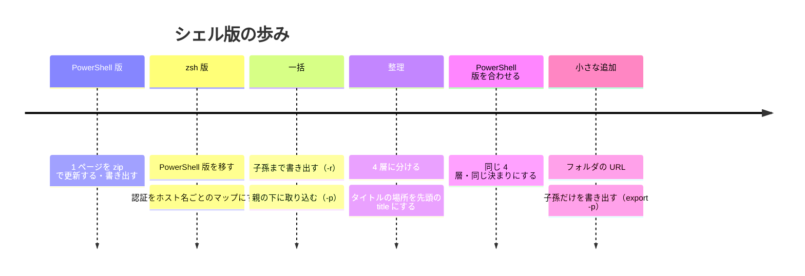
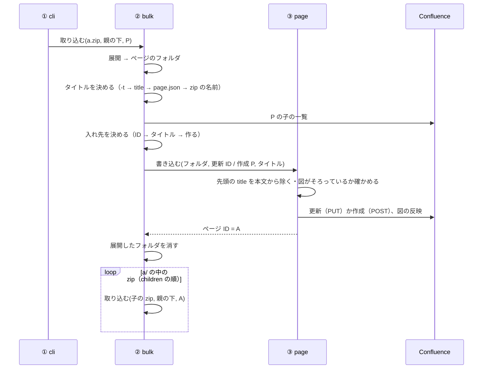
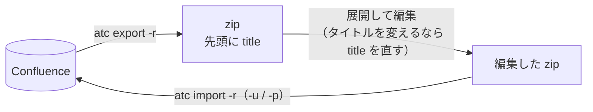

# atlassian-tools 要件

Atlassian Cloud（Confluence、のちに Jira・Bitbucket）を手元のファイルと行き来させる、小さなコマンドの集まりです。
1 つのリポジトリ（`atlassian-tools`）から、製品ごとに別のバイナリを作ります。

| バイナリ | 製品 | 状態 |
|---|---|---|
| `atc` | Confluence | 最初に作る。今のシェル版（zsh / PowerShell）の置き換え |
| `atj` | Jira | 予定。チケットの取り込み・書き出し |
| `atb` | Bitbucket | 構想だけ |

この文書は「何を作るか」を書きます。「どう作るか」は [design.md](design.md) に書きます。
今はシェル版のあるリポジトリ（rayrc）の `src/80_confluence/atlassian-tools/` に置いていますが、新しいリポジトリを作ったらそちらへ移します。

## 1. 背景

### 1.1 これまで

Confluence のページを zip で取り込む・書き出す関数を、シェルで書いてきました。



シェル版は rayrc（シェルの環境をそろえる dotfiles）の 1 つのモジュールです。rayrc の決まりで、同じ機能を zsh と PowerShell の両方で、同じ決まりのまま保つ必要があります。

### 1.2 なぜ作り直すのか

1. **2 つの方言を保つ手間**：機能を 1 つ足すたびに、zsh と PowerShell の両方を直し、両方を確かめる必要があります。
2. **シェルから curl を呼ぶことの相性の悪さ**：PowerShell 版を作るときにはまったことは、どれも Confluence とは関係がありません。
   - Windows PowerShell 5.1 は、ネイティブのコマンドの標準入力に書くとき、グローバルの `$OutputEncoding` しか見ない（既定は ASCII で、日本語が `?` になる）
   - curl.exe は、設定ファイル（`-K`）の中の日本語のパスを開けない
   - `-F` のファイル名の `;` `,` で切れる。`"` で囲むと、5.1 では引数の `"` が崩れる
   - BOM のない .ps1 は、5.1 では CP932 として読まれ、日本語が化ける
3. **確かめにくさ**：curl を関数で置き換えたモックでしか確かめられません。zsh 版は、Windows の手元では動かすことさえできません。

Go で 1 つのバイナリにすれば、HTTP・zip・ハッシュ・JSON を直接扱えるので、2 と 3 はなくなります。1 は、実装が 1 つになるのでなくなります。

### 1.3 既にある道具を使わない理由

2026-11 に調べました（rayrc の `src/80_confluence/refactoring.md` の 9 章）。次の条件をすべて満たすものは見つかりませんでした。

- 本文をストレージ形式（XHTML）のまま持つ（Markdown に変換しない。マクロが往復で失われない）
- ページを ID で当て、何度流しても同じ結果になる
- 図（添付）を中身のハッシュで比べ、変わっていないものは上げない
- Confluence Cloud に対応している
- Linux・macOS・Windows 向けの 1 つのバイナリがある

いちばん近いもの（ConfluenceImportExport、atlcli）も、フォルダ名がタイトル、変更の判定がファイルの更新時刻、本文が Markdown、などの点で合いません。
一方、シェル版で「何が正か」（3 章）と「形式」（4 章）の決まりは固まっています。そのため、決まりはそのままで、実装だけを Go に移します。

## 2. 言葉

| 言葉 | 意味 |
|---|---|
| ページのフォルダ | 1 ページ分のファイル（`page.xhtml`・`page.json`・図）。zip の中身 |
| ページの zip | ページのフォルダを zip にしたもの。名前は `<ページ ID>_<タイトル>.zip` |
| 子のフォルダ | ページの zip と同じ名前（`.zip` を除く）のフォルダ。子のページの zip を入れる |
| 親 | `-p` で指定するページかフォルダ（Confluence のフォルダ） |
| 入れ先 | 取り込む zip の中身を入れるページ。「ID X を更新」か「親 P の下に作成」 |
| 印 | この道具が上げた添付のコメント `sha256:<16 進の小文字>`。同じ中身か、この道具が上げたものかを見分ける |
| サイト | `https://<ホスト名>`。ホスト名は小文字にそろえる |

## 3. atc の機能

### 3.1 コマンド

```
atc import <zip>... [-u <URL か ID> | -p <親の URL か ID>] [-r] [-t <タイトル>] [-m <版のメッセージ>] [-e <メールアドレス>] [--no-prune]
atc export <URL か ID>          [-o <出力フォルダ>] [-e <メールアドレス>] [-f] [-r]
atc export -p <親の URL か ID>  [-o <出力フォルダ>] [-e <メールアドレス>] [-f] [-r]
```

オプションは zip の前にも後ろにも書けること（`atc import a.zip -p 123` も `atc import -p 123 a.zip` も同じ）。長い名前（`--url` `--parent` `--title` `--message` `--email` `--recursive` `--output-dir` `--force`）も使えること。

### 3.2 ページの指定（URL か ID）

次のどれかを受け付けます。前後の空白と `"` は取り除きます。

| 書き方 | サイト | ID |
|---|---|---|
| 数字だけ | 環境変数 `RAYRC_JIRA_BASE_URL`、なければ入力を求める | その数字 |
| `https://<ホスト>/wiki/.../pages/<数字>/...` | URL のホスト | `pages` の後ろで最初の数字だけの部分。`edit-v2` のような英小文字・数字・`-` だけの部分は読み飛ばす |
| `https://<ホスト>/wiki/.../folder/<数字>` | 同上 | `folder` の後ろで、同じ決まり |
| `https://<ホスト>/wiki/...?pageId=<数字>` | 同上 | `pageId=` の数字 |

- `pages` か `folder` のうち、先に出てくる方を使います。`?` と `#` より後ろは、この判定では見ません。
- 短縮 URL（`/wiki/x/...`）は、ページ ID が読めないので受け付けません。
- フォルダの ID は、子の一覧と、作るときの親（`ancestors`）で、ページの ID と同じように使えます（シェル版で確かめた）。

### 3.3 取り込み（import）

zip（ページのフォルダ）の中身で、Confluence のページを更新するか、新しく作ります。

**入れ先**

| 指定 | 入れ先 |
|---|---|
| `-u` も `-p` もなし | zip の名前の先頭の数字（`<ページ ID>_<名前>.zip`）のページを更新。zip が 1 つで名前に ID がなければ、入力を求める |
| `-u` | 指定したページを更新（zip が 1 つのときだけ） |
| `-p` | 親の直下。上から順に、最初に当たったもの<br>1. `page.json` の `site` が同じで、その `id` のページが親の直下にあれば、それを更新（タイトルを変えても同じページ）<br>2. 親の直下に同じタイトルのページがあれば、それを更新<br>3. どちらもなければ、親の下に作る |
| `-r`（上のどれかに足す） | zip を入れたページの直下に、子のフォルダの中の zip を、`-p` と同じ決まりで取り込む。孫から下も同じ |

- `-u` と `-p` は一緒に使えない。`-u` と `-t` は zip が 1 つのときだけ使える。
- ID で当てるのは、同じサイトで、しかもその親の直下にあるときだけ（別のサイトへ移すとき、ページが動かされたときはタイトルで探す）。
- `-r` で子を取り込む順番は、親の `page.json` の `children` の順。書いていないものは名前の順。

**タイトル**：上から順に、最初に見つかったもの。

1. `-t`
2. `page.xhtml` の先頭の `<title>` の文字（空なら次へ）
3. `page.json` の `title`
4. ページを更新するなら今のタイトルのまま。親の下に入れるなら zip の名前（拡張子と、先頭の `<数字>_` を除く）

**本文**：`page.xhtml` で丸ごと置き換える。先頭の `<title>` は、タイトルに使ったかどうかに関係なく、必ず本文から取り除く。BOM も取り除く。

**図（添付）**

1. 本文が `ri:attachment ri:filename="..."` で参照しているファイル（`&amp;` などは戻す）が、ページのフォルダにそろっているかを、**ページに書き込む前に**確かめる。足りなければ、何も書かずに止まる。
2. 参照している図のうち、ページの添付に同じ名前で同じ印（`sha256:<中身のハッシュ>`）があるものは上げない。それ以外は上げ、コメントに印を付ける（同じ名前があれば新しい版になる）。
3. `--no-prune` がなければ、印の付いた添付のうち、本文が参照しなくなったものを消す。印のない添付（人が画面から上げたもの）は消さない。
4. 添付の名前は、大文字・小文字を区別する。

**版**：本文を置き換えるときは、今の版 + 1 で送る。版のメッセージは `-m`（なければ決まった文言）。

**作業場所**：zip は一時フォルダに展開し、終わったら（失敗しても）消す。

### 3.4 書き出し（export）

ページを `<ページ ID>_<タイトル>.zip` に書き出します。そのまま import に渡せる形です。

| 指定 | 書き出すもの |
|---|---|
| `export P` | P だけ |
| `export -r P` | P と子孫。子は P の zip と同じ名前のフォルダに入れる（孫から下も同じ） |
| `export -p P` | P の直下の子だけ。出力フォルダに直接並べる。P は書き出さない |
| `export -p P -r` | P の子孫全部。孫から下は、子の zip と同じ名前のフォルダに入れる |

- zip の名前のタイトルの部分は、`\ / : * ? " < > |` と空白の続きを `_` 1 つにし、前後の `_` を除き、先頭から 60 文字までにする。
- すでに同じ名前の zip があれば止まる。`-f` で上書きする。
- `-o` を省略すると、今のフォルダに書き出す。
- `export -p` では、親の `page.json` がないので、子の並び順は残らない。
- 子のないページを `-p` に渡したら、何も書かずにそう伝えて、成功で終わる。
- ページの指定と `-p` は一緒に使えない。

### 3.5 認証

Basic 認証（`メールアドレス:API トークン`）です。

| 環境変数 | 中身 |
|---|---|
| `RAYRC_JIRA_BASE_URL` | ページ ID だけを渡したときのサイトの URL |
| `RAYRC_JIRA_EMAIL` | 「ホスト名=メールアドレス」をカンマか空白（改行も）で区切って並べたもの |
| `RAYRC_JIRA_TOKEN` | 「ホスト名=API トークン」を同じく並べたもの |

- 値は最初の `=` より後ろ全部（トークンが `=` を含んでもよい）。ホスト名の大文字・小文字は区別しない。
- 形の違う項目は、値を表示せずに警告して無視する。
- メールアドレスは `-e` が優先。見つからなければ入力を求める。トークンは画面に出さずに入力を求める。どちらも空なら止まる。
- 端末でないとき（パイプ、CI）は入力を求めず、止まる。
- 秘密（トークン）は、コマンドの引数・ログ・エラーメッセージに出さない。

環境変数の名前は、今の利用者の設定をそのまま使えるように、シェル版と同じにします（名前を変えるかは 8 章）。

## 4. 形式

### 4.1 ページのフォルダ

| ファイル | 中身 |
|---|---|
| `page.xhtml` | 本文（ストレージ形式）。書き出すときは、先頭に `<title>タイトル</title>` の 1 行を足す |
| `page.json` | 下の表 |
| 図 | 本文が参照するファイル。書き出すときは、ページのすべての添付（今の版） |

```xml
<title>ページのタイトル</title>
<p>ここから下は、API の body.storage.value のまま</p>
```

**`<title>` の決まり**

- 見るのは先頭だけです（BOM と空白は飛ばす）。`<title>` にも属性を許す（`<title lang="ja">`）。
- 中の文字は、`&amp; &lt; &gt; &quot; &apos;` と数値の参照（`&#12354;` `&#x3042;`）を戻し、空白の続きを 1 つに詰め、前後の空白を除いたもの。ほかの名前の参照（`&nbsp;` など）はそのまま残す。
- 書き出すときのエスケープは `& < > ' "` → `&amp; &lt; &gt; &#39; &quot;`。
- 先頭の `<h1>` はタイトルとして読まない（本文の見出し）。

`<h1>` ではなく `<title>` にした理由（本文の見出しとぶつからない、ストレージ形式で使わない要素、HTML の `<head>` と同じ考え方）は、rayrc の `refactoring.md` の 4.1 にあります。

**`page.json`**

| キー | 中身 |
|---|---|
| `id` | ページ ID（文字列） |
| `title` | タイトル |
| `version` | 版の番号 |
| `space` | スペースのキー |
| `site` | `https://<ホスト名>`（小文字） |
| `exportedAt` | 書き出した日時（`YYYY-MM-DDTHH:MM:SS`、手元の時刻） |
| `attachments` | `[{title, mediaType, comment}]` |
| `children` | `-r` で書き出したときだけ。`[{id, title}]`（Confluence での並び順） |

取り込むときは `title`・`site`・`id`・`children` だけを読み、ほかは知らせるための情報です。`page.json` がなくても取り込めます。

### 4.2 zip の配置

```
out/
├── 100_親.zip            ← page.json の children に子の並び順 [102, 101]
└── 100_親/
    ├── 102_子B.zip
    ├── 101_子A.zip
    └── 101_子A/
        └── 103_孫.zip
```

- zip の中の名前は UTF-8 にする。UTF-8 の印のない zip（Info-ZIP の `zip` が作るもの）も、名前を UTF-8 として読む。
- zip の中で `page.xhtml` はちょうど 1 つ（どの深さでもよい。そのフォルダがページのフォルダ）。
- 展開するとき、zip の外に出る名前（`../`）は受け付けない。

## 5. 動き

### 5.1 `atc import -p P -r a.zip`



### 5.2 往復



zip の側を正とします。Confluence の画面で直したときは、一度書き出してから編集します。

## 6. 品質

| 項目 | 要件 |
|---|---|
| 配布 | 1 つのバイナリ。Linux・macOS・Windows の amd64 と arm64。curl・jq・zip などの外部のコマンドに頼らない |
| 文字 | パス・添付の名前・タイトルに日本語、空白、`;` `,` `&` を含んでよい（Windows ではファイル名に使えない文字を除く） |
| 秘密 | トークンを引数・ログ・エラーに出さない |
| 何度流しても | 同じ zip をもう一度取り込んでも、新しいページはできず、変わっていない図は上げない |
| 途中の失敗 | 巻き戻しはしない。もう一度流せば、ID かタイトルで当たって更新になる |
| 書き込む前の確かめ | 図が足りない・引数がおかしい、などは、Confluence に何も書く前に止まる |
| 終わり方 | 成功は 0、失敗は 0 以外。メッセージは標準エラー出力 |
| 一覧 | ページ送り（`size` と `_links.next`）をたどり、全件を読む |

## 7. rayrc との関係

- rayrc は、GitHub のリリースから `atc`（のちに `atj`）を `libs/bin/` に入れるだけにします（install）。
- 今の関数の名前は、薄い入口として残します。Claude のスキル create-confluence-page が `Import-ConfluencePage` を呼んでいるためです。
  - PowerShell：`Import-ConfluencePage` / `Export-ConfluencePage` → `atc import` / `atc export`
  - zsh：`confluence-import` / `confluence-export` → 同上
- シェル版の 4 層は、`atc` で同じ結果が出ることを確かめてから消します。

## 8. 扱わないこと・決めていないこと

**扱わないこと**（シェル版と同じ）

- ページの消去と移動（zip にない子は消さない。別の親の下にある同じページは動かさない）
- ページ同士のリンクの付け替え
- 途中で失敗したときの巻き戻し
- 短縮 URL

**決めていないこと**

| 項目 | 選択肢 | 今の考え |
|---|---|---|
| 環境変数の名前 | `RAYRC_JIRA_*` のまま / 道具の名前（`ATLASSIAN_*` など）に変え、古い名前も読む | 公開する道具に `RAYRC_` は似合わない。新しい名前を正にして、`RAYRC_JIRA_*` も読む形がよさそう |
| メッセージの言語 | 日本語のまま / 英語 | 公開するなら英語。最初は日本語のままでもよい |
| 変わっていない本文 | 毎回版を上げる（今） / 同じなら送らない | Confluence がストレージ形式を整え直すので、単純に比べると「違う」になりやすい。確かめてから決める |
| REST API の版 | v1（今） / v2 | v1 の `content` は v2 への移行が進んでいる。まず v1 で同じ動きを作り、④ の中だけで v2 に替えられるようにしておく |
| 子の並び順（`export -p`） | 残さない（今） / 出力フォルダに順番だけのファイルを置く | 困ったら足す |
| 速さの上限（429） | 何もしない（今） / `Retry-After` を見て待つ | Go 版では入れたい |

## 9. 受け入れの基準

`atc` をシェル版の置き換えとして受け入れるのは、次がそろったときです。

1. 下の場合を、偽の Confluence（`httptest`）に対するテストで確かめている。Linux と Windows の CI で通る。
   - URL の読み取り（数字、`pages`、`folder`、`edit-v2`、`pageId=`、`pages/123abc` の読み飛ばし、短縮 URL の拒否）
   - 認証のマップ（大文字・小文字、`=` を含むトークン、形の違う項目）
   - `<title>` の読み書き（エスケープ、空の `<title>`、先頭の `<h1>` を本文に残す、BOM）
   - 書き出しの木の形、`children` の順、`-f`、`-p`、`-p -r`、子のないページ
   - 書き出したものをそのまま取り込む：新しいページができない。印のない添付は 1 回だけ上げ直し、2 回目は何も上げない
   - `-p` での作成と、もう一度流したときの更新（タイトルで当たる）
   - `<title>` でタイトルを変えた zip を `-p` で取り込む → ID で当たって、同じページの名前が変わる
   - `-t` の優先、`page.json` の `title`、zip の名前
   - 図の削除（`--no-prune` で残る、印のない添付は残る）
   - 名前に日本語・空白・`;` `,` を含む図
   - 図が足りないときに何も書かないこと、引数の誤り、HTTP のエラー
2. 本物の Confluence で、マクロの多いページを 1 枚、書き出す → 何も変えずに取り込む、を流し、本文に差が出ないこと。
3. シェル版と `atc` で同じページを書き出し、zip の中身が同じこと（`page.json` はキーの並びと空白を除いて比べ、`exportedAt` は比べない）。

## 10. atj・atb

**atj（Jira）**：チケットの取り込み・書き出しを考えています。中身はまだ決めていません。決まっているのは次のことだけです。

- 認証は Confluence と同じ（同じ Atlassian のアカウントと API トークン、同じホスト名のマップ）。
- コマンドの形は `atc` にそろえる（`atj import` / `atj export`）。
- 何が正か・形式は、`atc` と同じように、この文書に章を足して先に決める。

**atb（Bitbucket）**：構想だけです。
