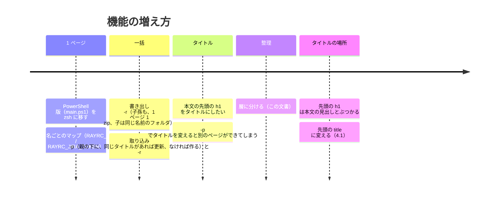
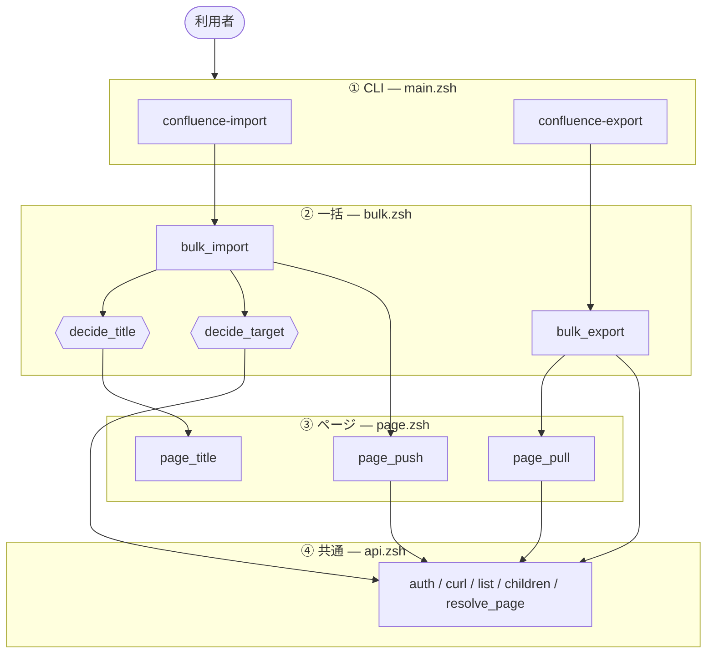
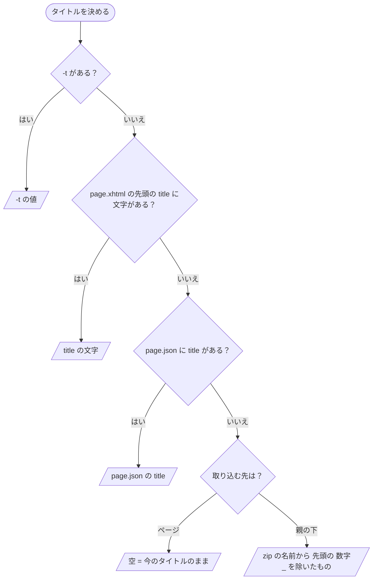
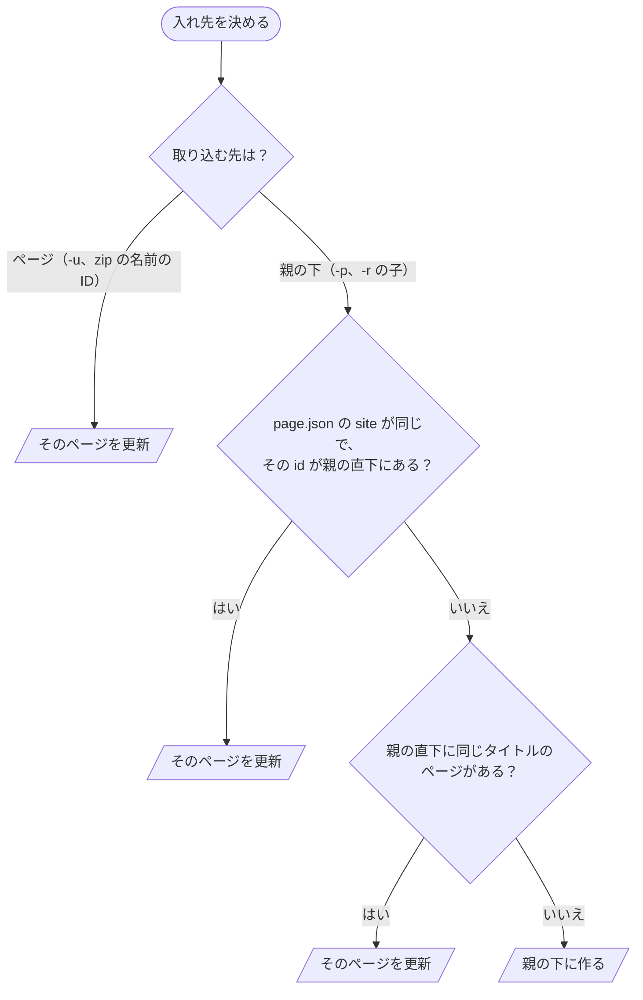
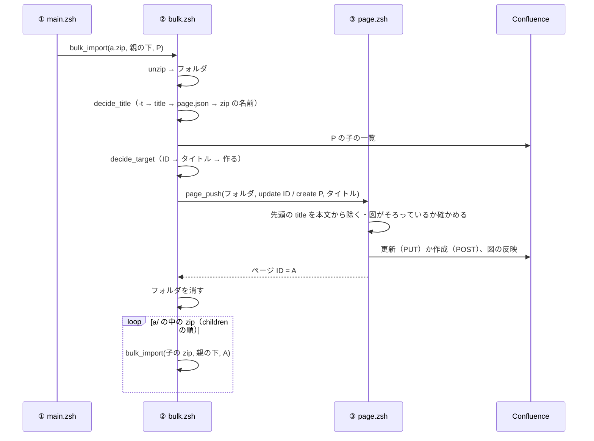
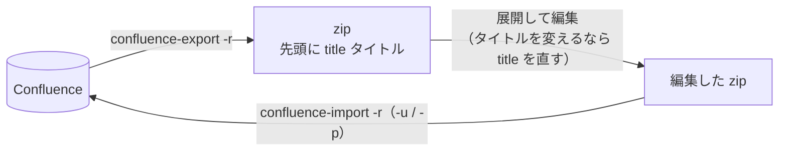

# Confluence モジュール（zsh 版）の整理

Confluence のページを zip で取り込む・書き出す zsh の関数（`confluence-import` / `confluence-export`）を、層に分けて整理したときの記録です。
何がどこで決まるのか（何が正か）を、コードを読まなくてもわかるようにすることが目的です。

## 1. 経緯



一括の機能を足したところで、次のような判定が 1 ページ分の取り込みの関数の中に積み重なっていきました。

- このページは ID で更新するのか、親の下でタイトルから探すのか
- タイトルは `-t` か、`page.json` か、zip の名前か
- 子のフォルダをたどるか、どの順に取り込むか

それぞれは正しく動いていました。しかし、zip の展開、REST API の呼び出し、再帰が同じ関数に混ざっていて、「最終的にどのページに、どのタイトルで入るのか」はコードを追わないとわかりませんでした。
そこに「先頭の `<h1>` をタイトルにする」という決まりを足すと、さらに場合分けが増えます。そのため、先に層を分けて、判定を 1 か所に集めることにしました。

## 2. 層



| 層 | ファイル | 責任 | 知らないこと |
|---|---|---|---|
| ① CLI | `main.zsh` | オプションを読んで確かめ、取り込む先の種類（ページか、親の下か）を決めて ② に渡す。②〜④ を読み込む | API、zip の中身 |
| ② 一括 | `bulk.zsh` | zip の展開と作成、フォルダの入れ子、たどる順番。**タイトルと入れ先の決定** | REST API の細かいこと |
| ③ ページ | `page.zsh` | ページのフォルダと Confluence のページ 1 枚を行き来させる。言われたとおりに「ID X を更新」「親 P の下に作成」をする | zip、入れ子、どれが正しい入れ先か |
| ④ 共通 | `api.zsh` | 認証、curl、ページ送りのある一覧、URL の読み取り | 上のすべて |

決めごとは 2 つです。

- **zip を扱うのは ② だけ**です。③ は展開済みのフォルダしか見ません。
- **判定は ② の `decide_title` と `decide_target` の 2 つだけ**で行います。③ は判定をせず、渡された `update <ID>` か `create <親 ID>` をそのまま実行します。

例外が 1 つあります。zip の名前の ID（`<ページ ID>_<名前>.zip`）は ② の決まりですが、`-u` がないときに ① がそれを読みます（`__rayrc_cf_zip_id` を ② から呼ぶ）。どのページに入れるかを利用者の指定から決めるのが ① の仕事なので、ここは ① に置いています。

## 3. 何が正か

### 3.1 タイトル（`decide_title`）

上から順に、最初に見つかったものを使います。



- 見るのは **先頭** の `<title>` だけです（BOM と空白は飛ばします）。`<h1>` は、先頭にあっても本文の見出しとして扱います。
- 先頭の `<title>` は「タイトルの場所」です。タイトルに使ったかどうか、文字が空かどうかに関係なく、**本文からは必ず取り除きます**（③ の決まり）。そのため、`-t` を付けても `<title>` が本文に残ることはありません。

### 3.2 入れ先（`decide_target`）



- ID で当てるのは、同じサイトで、しかも **その親の直下にある** ときだけです。別のサイトへ移すとき（ID に意味がない）や、ページが別の場所へ動かされたときは、タイトルで探します。
- ID で当たるので、`<title>` でタイトルを変えた zip を `-p` で取り込んでも、別のページはできません。同じページの名前が変わります。

### 3.3 どの組み合わせでどうなるか

| コマンド | 入れ先 | タイトル |
|---|---|---|
| `confluence-import 123_a.zip` | 123 を更新 | `-t` → `<title>` → `page.json` → 今のまま |
| `confluence-import -u X a.zip` | X を更新 | 同上 |
| `confluence-import -p P a.zip b.zip` | P の直下（ID → タイトル → 作る） | `-t` → `<title>` → `page.json` → zip の名前 |
| 上のどれかに `-r` | zip を入れたページの直下に、`a/` の中の zip を入れる（`-p` と同じ決まり）。孫以下も同じ | `<title>` → `page.json` → zip の名前 |

`-u` と `-p` は、どちらも「zip の入れ先」を決めるので、一緒には使えません。`-u` と `-t` は zip が 1 つのときだけ使えます。

## 4. 形式

### 4.1 ページのフォルダ（zip の中身。③ の決まり）

| ファイル | 中身 |
|---|---|
| `page.xhtml` | 本文（ストレージ形式）。先頭の `<title>` はタイトルの場所。書き出しでは先頭に `<title>タイトル</title>` の 1 行を足し、取り込みでは取り除く |
| `page.json` | `id`、`title`、`version`、`space`、`site`、`exportedAt`、`attachments`（`children` は ② が足す） |
| 図 | 本文が `ri:attachment ri:filename="..."` で参照するファイル |

```xml
<title>ページのタイトル</title>
<p>ここから下は、API の body.storage.value のまま</p>
```

**タイトルの場所を `<h1>` ではなく `<title>` にした理由**

- Confluence では、タイトルは本文の外の項目です。REST API の JSON では `title` と `body.storage.value` が別々で、本文にはタイトルも `<h1>` も入りません。
- `<h1>` は、本文の見出しとして普通に使えます。先頭の `<h1>` をタイトルの場所にすると、`<h1>` で始まる本文（手で書いたもの、別の道具で作ったもの）の見出しがタイトルになり、本文から消えます。
- `<title>` はストレージ形式では使わない要素なので、本文とぶつかりません。HTML の `<head>` のタイトルと同じ考え方で、Confluence の HTML 書き出しも `<title>` にタイトルを入れます。
- 別のファイル（`page.json` だけ）にタイトルを持たせると、本文を編集するついでにタイトルを直せません。そのため、1 つのファイルの中に置きます。
- `<html><head>…<body>` では包みません。包むと、`<title>` の行より下がストレージ形式そのままではなくなり、差分を見るときも、本文をそのまま貼るときも扱いにくくなるからです。

### 4.2 zip の配置（② の決まり）

```
out/
├── 100_親.zip            ← page.json の children に子の並び順 [102, 101]
└── 100_親/
    ├── 102_子B.zip
    ├── 101_子A.zip
    └── 101_子A/
        └── 103_孫.zip
```

`-r` で取り込むときは、`page.json` の `children` の順に取り込みます。書いていないものは名前の順です。

書き出しの `-p` は、取り込みの `-p`（P の子として入れる）の裏返しで、親 P そのものは書き出しません。

| コマンド | 書き出すもの |
|---|---|
| `confluence-export P` | P だけ |
| `confluence-export -r P` | P と子孫（P の zip と、同じ名前のフォルダ） |
| `confluence-export -p P` | P の直下の子だけ。出力フォルダに直接並べる |
| `confluence-export -p P -r` | P の子孫全部。孫から下は、子の zip と同じ名前のフォルダ |

`confluence-import -p P -r <出力フォルダ>/*.zip` で同じ形に戻せます。P はフォルダでもかまいません。ただし、親の `page.json` がないので、子の並び順は残りません（既存のページの更新では並びを動かさないので困らない。新しく作るときは zip の名前の順になる）。

## 5. 流れ

### 5.1 `confluence-import -p P -r a.zip`



### 5.2 往復の使い方



zip の側を正とします。Confluence の画面で直したときは、一度書き出してから編集します。そうしないと、古い zip を取り込んだときに画面での変更（タイトルを含む）が戻ります。

## 6. コミット

| コミット | 内容 |
|---|---|
| `refactor(confluence): split the zsh module into cli / bulk / page / api layers` | 層に分けた。動きは変えていない（「図が zip にありません」が「図がありません」になった程度） |
| `feat(confluence): take the title from the leading <h1>, match -p children by id` | 3.1 と 3.2 の決まり、4.1 の `<h1>` の扱い。変えたのは `decide_title`・`decide_target` と ③ の形式だけ |
| `feat(confluence): keep the title in a leading <title> instead of <h1>` | タイトルの場所を `<h1>` から `<title>` に変えた（4.1 の理由）。変えたのは ③ の形式と、`decide_title` が呼ぶ関数だけ |

機能のコミットの差分が ② の 2 つの関数と ③ の形式に収まっていることが、層を分けた効果です。

## 7. 残っていること

- **PowerShell 版**：zsh 版と同じ 4 層（`main.ps1` / `bulk.ps1` / `page.ps1` / `api.ps1`）、同じ決まり（3 章）、同じ形式（4 章）に合わせました（I8）。違うのは仕組みだけです。
  - コマンドの名前は `Import-ConfluencePage` / `Export-ConfluencePage`（スキル create-confluence-page がこの名前を使う）。オプションは `-Url` `-Parent` `-Title` `-Message` `-Email` `-Recursive` `-NoPrune` / `-OutputDir` `-Force` で、zsh 版の 1 文字のもの（`-u` `-p` `-t` `-m` `-e` `-r` / `-o` `-f`）も別名で使えます。zip は空白で区切って何個でも渡せます。
  - 失敗は `throw` で知らせます（zsh 版の「メッセージを出して `return 8`」）。②〜④ の関数は `New-Module` の中に閉じ込め、外に出すのは 2 つのコマンドだけです。
  - zip は .NET の `System.IO.Compression` で扱います。展開では、UTF-8 の印のない名前も UTF-8 として読みます（Info-ZIP の `zip` が作る zip のため）。
- **古い zip**：`<title>` に変える前の zsh 版で書き出した zip は、先頭に `<h1>タイトル</h1>` があります。今はこれを本文の見出しとして扱うので、そのまま取り込むと本文の先頭に見出しが増えます。書き出し直すか、`<h1>` の行を `<title>` に直してから取り込みます（決まりを増やさないために、`<h1>` は読まないことにしました）。4 層に合わせる前の PowerShell 版で書き出した zip には `<title>` がないので、タイトルは `page.json` から取ります。
- **扱っていないこと**：ページの消去と移動（zip にない子は消さない。別の親の下にある同じページは動かさない）、ページ同士のリンクの付け替え、途中で失敗したときの巻き戻し（もう一度流せば、ID かタイトルで当たって更新になる）。
- **再設計**：この整理は、今の動きのまま層を分けたものです。決まりそのものの見直しは、別のセッションで行う予定です。方向は「9. これから」を参照してください。

## 8. 確かめ方

`src/80_confluence/` の 4 つの zsh ファイルは、Alpine の zsh 5.9 で、ページの木・版・添付を持つ curl のモックに対して確かめました。確かめたことは次のとおりです。

- 書き出しの木の形、子の並び順、`<title>` の付け方（`&` などのエスケープを含む）
- 新しい親の下への作成と、もう一度流したときの更新
- `-r` なし、複数の zip、引数の誤り
- `<title>` によるタイトルの変更、`-t` の優先、先頭の `<h1>` を本文に残すこと、空の `<title>` で `page.json` の title を使うこと
- `-p` での ID による当て方（同じサイト・別のサイト・親の直下にない場合）

本物の Confluence と macOS ではまだ確かめていません。

テストの台本はリポジトリに入れていません（このセッションの `/tmp/cftest/` にあっただけです）。作り直すときの要点は次のとおりです。

- `apk add zsh zip unzip jq curl` した `alpine` のコンテナに、作業ツリーを読み取り専用でマウントする。
- `__rayrc_module_common_setup() { __rayrc_ctl_dir=<src/80_confluence>; }` を定義してから `main.zsh` を source する。
- `curl` を zsh の関数で置き換えてモックにする。**`__rayrc_cf_curl` は `$(curl ...)` の中、つまりサブシェルで curl を呼ぶ**ので、モックの状態（ページ、版、添付）はシェルの変数ではなくファイルに持つ。

## 9. これから：自作をやめて、ツールを選ぶ

> 2026-11-25 追記：この章の調べの結果を受けて、Go で作り直すことにしました（リポジトリ `atlassian-tools`、Confluence 用のバイナリ `atc`）。要件と設計は [atlassian-tools/requirement.md](atlassian-tools/requirement.md) と [atlassian-tools/design.md](atlassian-tools/design.md) にあります。

### 9.1 考え直したこと

このリポジトリ（rayrc）の役目は、ツールそのものを作ることではありません。**ツールを集めて管理すること**です。PowerShell と zsh で書き始めたのは、すぐに作れたからでした。しかし、ここまで大きくなると、シェルで書き続けるのは筋がよくありません。

- Confluence のページの CRUD（さらに Jira のチケットの CRUD）は、Go か Rust の 1 つのバイナリにするのがよい。PowerShell 版と zsh 版の 2 つを同じ決まりで保つ手間（I8）もなくなる。
- rayrc は、GitHub のリリースにあるそのバイナリを `libs/bin/` に入れて管理する（`.claude/rules/bash.md` の取得方法の優先順位に沿う）。
- 自分で作るより先に、**世の中にすでにあるツールを探す**。

### 9.2 探す基準

自作した理由は、CRUD ができる道具がなかったからではありません。**1 ページ 1 zip という手元の形と、木の形の決まりに合う道具が見つからなかったから**です。そのため、道具を選ぶときに CRUD の実装は見るところの 1 つでしかなく、本当に見るべきなのは次の 2 つです。

**A. ページを手元でどう表すか**
- 本文の形式：ストレージ形式（XHTML）のまま持つか、Markdown などに変換するか。変換するなら、Confluence のマクロ（`ac:` / `ri:` の要素）が往復で失われないか。
- 図（添付）を、ページの隣のファイルとして持てるか。
- タイトルをどこに持つか（先頭の `<h1>`、front matter、メタデータのファイルなど）。
- ページの ID をどこに持つか。ID を持てないと、改名したときに別のページができる（3.2 で起きた問題）。

**B. 定期的に取り込むときの、構造の決まり**
- フォルダの入れ子とページの親子を対応させられるか。子の並び順を持てるか。
- 取り込みを何度流しても同じ結果になるか（ID → タイトル → 作成、のように当て方が決まっているか）。
- 変わっていないページや図を送らないか（版や添付が無駄に増えないか）。
- 手元にないページを消すか残すか、選べるか。試しに流す（dry run）ことができるか。
- 書き出し → 編集 → 取り込み、を繰り返しても中身が崩れないか（5.2 の往復）。

**C. そのほか**
- Confluence Cloud の API（v1 / v2）に対応しているか。認証を環境変数で渡せるか。サイトごとに認証を変えられるか（今のホスト名のマップ）。
- Jira も同じ道具（か、同じ作りの道具）で扱えるか。
- macOS・Linux・Windows 向けの 1 つのバイナリが GitHub のリリースにあるか（rayrc で管理できるか）。

### 9.3 調べた結果（2026-11-23）

各ツールの README・ドキュメント・リリースページで、9.2 の基準に照らして調べました。★の数とリリースは調べた日の値です。1 位と 2 位の最新リリースは、GitHub API でも確かめています。

**9.2 の基準をすべて満たすもの（本文をストレージ形式のまま持つ、ID で当てて何度流しても同じ結果になる、図をハッシュで比べる、Cloud に対応、3 つの OS 向けの 1 つのバイナリ）は見つかりませんでした。**

| 順位 | ツール | 本文 | 木の形と同期 | 配布 | Jira | 主な差 |
|---|---|---|---|---|---|---|
| 1 | [YuriyEnshin/ConfluenceImportExport](https://github.com/YuriyEnshin/ConfluenceImportExport)（C#、MIT、★7、v2.20.1 2026-09） | ストレージ形式のまま（`index.html`）。図は同じフォルダ | 1 ページ 1 フォルダ。照合は ID（`--match-by-title` でタイトルも）。変わっていないページと図は送らない。`--dry-run`。両方で変わっていると衝突として止まる | 1 つのバイナリ：win-x64・linux-x64・osx-arm64 | なし | フォルダ名がタイトルなので、OS ごとに使えない文字の扱いが違う。変更の判定がファイルの更新時刻なので、zip や git と合わないおそれがある。並び順と図の消去は未確認。個人開発 |
| 2 | [BjoernSchotte/atlcli](https://github.com/BjoernSchotte/atlcli)（TypeScript、Apache-2.0、★53、v2026.11.3 2026-11。[同期の説明](https://atlcli.sh/confluence/sync/)） | Markdown に変換。対応しないマクロは生の XML のブロックで残すが、変換で失われる例もドキュメントにある | `parent.md` と同じ名前の `parent/` フォルダ（4.2 と同じ考え方）。ID は front matter。タイトルは front matter か先頭の H1。3-way merge で衝突を扱う | 1 つのバイナリ：macOS・Linux（arm64/x64）・Windows x64。大きい（圧縮で 72〜86MB） | あり（issue、sprint、board） | Markdown 前提でストレージ形式のままは持てない。並び順と消去の扱いは未確認 |
| 3 | [rvben/confluence-cli](https://github.com/rvben/confluence-cli)（Rust、MIT、★7、v0.1.41 2026-11） | Markdown。変換で失われる部分はストレージ形式の断片のまま残す | `pull → plan → apply`。`.confluence.json` に ID・版・ハッシュ。リモートの図の消去は `--delete-remote` のときだけ | macOS・Linux。**Windows なし** | なし | まだ初期の版。新しいページを作れるかと並び順は未確認 |

**候補から外したもの**

| ツール | 外した理由 |
|---|---|
| kovetskiy/mark（Go、★1.6k） | Markdown から上げるのが中心。ページはスペースとタイトルで決める。書き出しは試験的 |
| Atlassian 公式の `acli` | Confluence のコマンドがない（Jira と管理だけ） |
| ankitpokhrel/jira-cli（Go、★6k） | Jira だけ。Jira 側の候補にはなる |
| open-cli-collective の cfl / jtk（Go） | 1 ページ単位の CRUD は `--body-format xhtml` でストレージ形式のまま扱え、Jira 版の jtk もあり、3 つの OS 向けに配布している。ただし木の同期はない。**今の zip の方式を残して、API の部分だけを置き換える候補になる** |
| mazuninky/atl（Rust） | Confluence と Jira の CRUD、ストレージ形式の入出力、3 つの OS。ただし木の同期はない |
| isukharev/atl（Go） | ストレージ形式のままで考え方は近いが、Server/DC だけで Cloud と Windows に対応しない |
| pchuri/confluence-cli（Node） | 再帰の書き出しはできるが、木の取り込みがない |
| text2confl、md2conf、markdown-confluence など | Markdown から Confluence への片方向だけ |
| Confluence から Markdown への書き出しだけのツール | 取り込みがない |

**次のセッションまでに確かめたいこと**

1. 1 位：子の並び順を保つか。自分で上げた図のうち使われなくなったものを消すか。更新時刻での判定と、zip や git での運用が合うか。新しいエディタで作ったページが往復で崩れないか。
2. 2 位：同じ点に加えて、手元で消したファイルがリモートで消えるか。`push` だけを試しに流せるか。
3. 3 位：新しいフォルダから新しいページを作れるか。Windows 向けのビルドの予定があるか。
4. どのツールでも：`ac:` / `ri:` のマクロが多いページを 1 枚選び、書き出す → 何も変えずに取り込む、を本物で流す。版が増えないことと、本文に差が出ないことを見るのがいちばん確かです。
5. 組み合わせ：1 ページ 1 zip の方式は残し、API の部分だけを cfl/jtk（Go）に置き換える。Jira は jtk か jira-cli にする。

ここまでで決めた「何が正か」（3 章）と「形式」（4 章）は、ツールを選ぶときの物差しとしても使えます。

## 10. 残しておく知識

### 10.1 関数の寿命

`main.zsh` は、rayrc の決まりで **シェルを起動するたびに読み込まれます**（`.zshrc` の managed block → `src/main.zsh` → 各モジュールの `main.zsh`）。そのため、4 つのファイルの関数（`confluence-*` と `__rayrc_cf_*`）は、**そのシェルを閉じるまで残ります**。片付くのは、読み込みのためだけの `__rayrc_main` だけです（define-call-unset）。

- 残っていても害はほとんどありません。ただし、`__rayrc_cf_<Tab>` で補完に出てくるなど、名前の空間は広がります。
- `__rayrc_cf_curl` などが認証（`email:token`）を `REPLY` に入れて返すので、`confluence-*` は最初に `local REPLY reply` を宣言しています。こうしておくと、関数を抜けたあとのシェルに秘密が残りません。

本当にその場だけで作るなら、次のような方法があります。シェルで書き続けるのはやめる方向（9 章）なので、どれも入れていません。

| 方法 | 関数が生きている間 |
|---|---|
| 今（`main.zsh` で source） | シェルを閉じるまで |
| zsh の `autoload`（`fpath`） | 最初に呼んでから、シェルを閉じるまで |
| 独立したスクリプトにする（I7。`10_viewer/48_lfscp/lfscp` と同じ形） | 1 回の実行の間だけ（別のプロセス） |
| Go / Rust のバイナリ（9 章） | 1 回の実行の間だけ |

### 10.2 Confluence の API

- 使っているのは REST API v1（`/wiki/rest/api/content`）です。子の一覧は `/content/<id>/child/page`、添付は `/content/<id>/child/attachment` です。一覧はページ送りになっていて、`size` と `_links.next` で続きを読みます。
- **同じスペースの中で、ページのタイトルは重複できません**。親の下に作るとき、同じタイトルが別の場所にあると 400 になります。
- 添付の更新は `PUT /content/<id>/child/attachment` に `X-Atlassian-Token: no-check` を付けます。同じ図かどうかは、添付のコメントに入れた `sha256:<16 進>` で比べています。この関数が上げた図だけを消すのも、この印で見分けています。
- 短縮 URL（`/wiki/x/...`）からはページ ID が読めないので、受け付けていません。
- フォルダの URL（`/wiki/spaces/<KEY>/folder/<id>`）は、ページの URL と同じように受け付けます。フォルダの ID は、子の一覧（`/content/<id>/child/page`）でも、作るときの親（`ancestors`）でも、ページの ID と同じように使えます（`-p <数字>` で確かめた）。
- 認証は Basic（`メールアドレス:API トークン`）です。zsh 版も PowerShell 版も `curl -K -` で標準入力から渡して、プロセスの一覧に出ないようにしています。

### 10.3 zsh で書いていてはまったこと

- **`[[ ... ]]` の中の `>`**：`[^>]` のように書くと、比較の演算子として読まれて構文エラーになります。`[^\>]` と書きます。
- **`$(...)` はサブシェル**です。その中で変えた変数は戻ってきません（8 章のモックの話）。
- **`path` は特別な変数**です（`PATH` とつながった配列）。ファイルのパスを入れる変数の名前に使ってはいけません。
- 人のシェルで動く関数は、最初に `emulate -L zsh` を書いて、利用者の `setopt` の影響を受けないようにします。後片付けは `{ ... } always { ... }` で書きます（`return` で抜けても動きます）。
- `zparseopts -F` で、知らないオプションをエラーにできます（zsh 5.8 から）。値を取るオプション（`-p` など）は、次の引数を値として取ります。`-p parent.zip` は「親が parent.zip」になります。
- **BOM（U+FEFF）**：このセッションの編集ツールでは、エスケープ（バックスラッシュ・u・feff の 6 文字）を書くと、見えない文字そのものに変わってしまいました。jq では `explode[0] == 65279`、zsh では `n=65279; ${(#)n}` と、文字コードの数で書いています。

### 10.4 PowerShell で書いていてはまったこと

Windows PowerShell 5.1 と PowerShell 7 の両方で、curl.exe を関数で置き換えたモック（モックの状態は PowerShell の変数に持てる。サブシェルがないので）と、本物の curl.exe をローカルの TCP リスナーに向けて、確かめました。

- **ファイルは UTF-8 の BOM 付き**で保存します（`.editorconfig`）。BOM がないと、5.1 は CP932 として読み、日本語の文字列が化けます。
- **curl.exe は、設定（`-K`）の中の日本語のパスを開けません**（exit 26。引数なら開ける）。`; ,` を含むパスは引数では切れてしまい、`"` で囲むと 5.1 では引数の `"` が崩れます。そのため、添付は ASCII の名前の写し（`.up_*`）を作業フォルダからの相対パスで渡し、本当の名前は `filename="..."` で渡しています（開かずに送るだけなので、UTF-8 のまま届く）。
- **5.1 は、ネイティブのコマンドの標準入力に書くとき、グローバルの `$OutputEncoding` しか見ません**。既定は ASCII で、日本語が `?` になります。関数の中で代入しても効かないので、`$global:OutputEncoding` を一時的に変えて、`finally` で戻しています。
- **`return , $array` を `@()` で受けると、配列が入れ子になります**（要素が 1 つの配列）。一覧の関数は 1 件ずつ出して、受ける側で `@()` で包みます。
- **`'{0}' -f ++$n` は値になりません**（`++$n` は式の中では何も出さない）。前の PowerShell 版の書き出しは、添付があるとここで落ちていました。
- 添付の名前は大文字・小文字を区別します。PowerShell の `@{}`・`-eq`・`-contains` は区別しないので、`[StringComparer]::Ordinal` の Hashtable・`-ceq`・`-cnotcontains` を使います。
